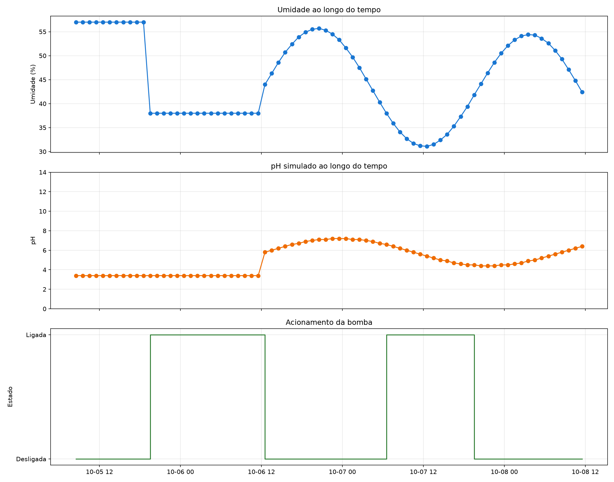
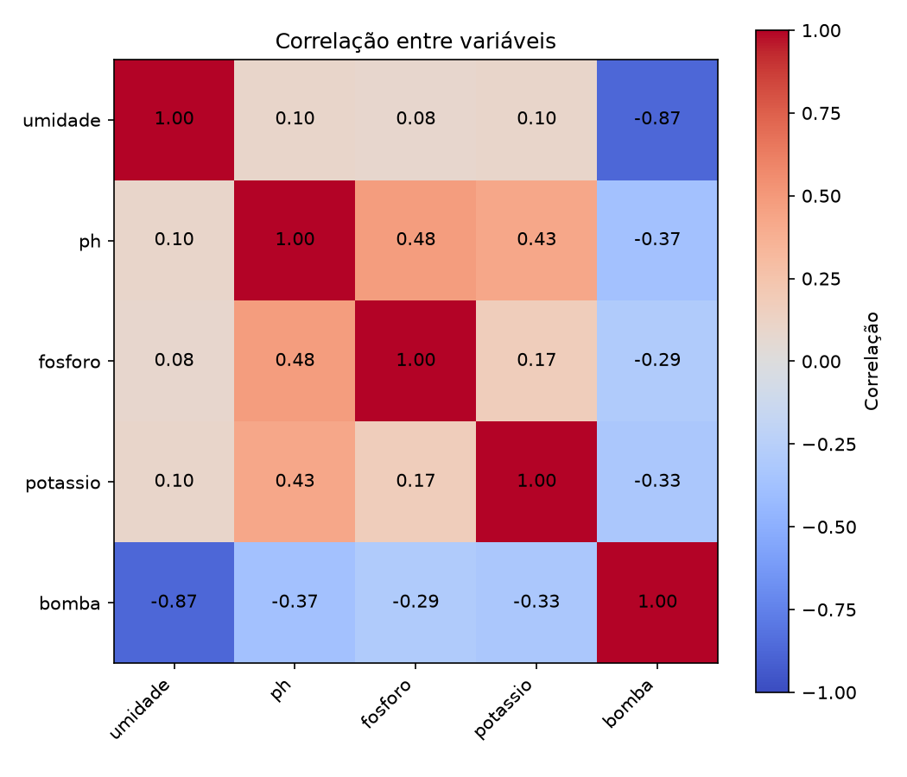

# FIAP - Faculdade de Informática e Administração Paulista

# ROOTSO — Fase 3: Colheita de Dados e Insights

## Nome do grupo

ROOTSO

## 👨‍🎓 Integrantes

- [Matheus Conciani](https://github.com/matheusconciani) — RM559473

## 👩‍🏫 Professores

### Professora

- [Sabrina Otoni](https://github.com/SabrinaOtoni)

### Coordenador

- [André Godoi Chiovato](https://www.linkedin.com/in/andregodoichiovato/)

## 📜 Descrição

Projeto da Fase 3 da disciplina de Tecnologia e Inovação da FIAP. O objetivo é
transformar dados de um circuito agrícola simulado em informações organizadas,
persistidas em Oracle e analisadas com Python e Polars.

O fluxo contempla:

- coleta de leituras do firmware no Wokwi;
- persistência em Oracle executado no Docker;
- importação repetível dos registros CSV;
- tratamento e análise exploratória com Polars;
- indicadores, gráficos e correlações;
- identificação explícita dos dados simulados.

Os dados não representam medições físicas reais. Os registros adicionais foram
identificados com a origem `simulador_diversificado`.

## 📁 Estrutura de pastas

```text
.
├── dados/
│   ├── bruto/              # Monitor Serial bruto, ignorado pelo Git
│   └── tratado/            # CSVs e indicadores gerados
├── docs/
│   ├── imagens/            # Gráficos para documentação
│   ├── ANALISE-DADOS.md   # Interpretação dos resultados
│   └── INSTALACAO-DOCKER-WINDOWS.md
├── scripts/                # Importação, geração e análise em Python
├── sql/                    # Schema e consultas Oracle
├── wokwi/                  # Firmware e bibliotecas do circuito
├── docker-compose.yml
└── requirements.txt
```

## 📎 Links e observações

- [Repositório da entrega](https://github.com/matheusconciani/rootso-data)
- [Template FIAP Portfólio AI](https://github.com/fiap-tutoria/FIAP-PORTFOLIO-AI)
- [Análise detalhada dos dados](docs/ANALISE-DADOS.md)
- [Roteiro do vídeo](docs/ROTEIRO-VIDEO.md)
- [Gráficos da análise](docs/imagens/)

### Decisões técnicas

- **Oracle Free em Docker:** ambiente isolado e reproduzível para persistência.
- **Polars:** processamento tabular eficiente e adequado ao volume da atividade.
- **Python `oracledb`:** conexão direta ao Oracle em modo thin, sem Oracle
  Client instalado localmente.
- **Origem dos dados:** cada registro informa se veio do simulador original ou
  da massa diversificada gerada para a análise.

## 🔧 Como executar

### 1. Configurar o Oracle

Crie o arquivo local de credenciais e defina senhas próprias:

```powershell
Copy-Item .env.example .env
notepad .env
docker compose up -d
```

O arquivo `.env` nunca deve ser publicado.

### 2. Criar a tabela

```powershell
docker cp .\sql\01_schema.sql rootso-oracle:/tmp/01_schema.sql
docker exec -it rootso-oracle sqlplus "ROOTSO@FREEPDB1" "@/tmp/01_schema.sql"
```

### 3. Instalar dependências e importar dados

Salve o Monitor Serial em `dados\bruto\monitor_serial.txt` e execute:

```powershell
python -m pip install -r requirements.txt
python scripts\importar_leituras.py dados\bruto\monitor_serial.txt
```

### 4. Gerar dados diversificados (opcional)

Os 28 registros originais devem ser preservados. Para adicionar a massa
didática diversificada uma única vez:

```powershell
python scripts\gerar_dados_diversificados.py
```

### 5. Gerar a análise

```powershell
python scripts\analisar_leituras.py
```

Os CSVs são salvos em `dados\tratado` e os gráficos em `docs\imagens`.

### 6. Consultar indicadores no Oracle

```powershell
docker cp .\sql\03_consultas_indicadores.sql rootso-oracle:/tmp/03_consultas_indicadores.sql
docker exec -it rootso-oracle sqlplus "ROOTSO@FREEPDB1" "@/tmp/03_consultas_indicadores.sql"
```

## 📊 Resultados visuais

### Leituras ao longo do tempo



### Correlação entre variáveis



### Assista a demo
![Video demonstração] (https://www.youtube.com/watch?v=Dx4e4OINxjg)
## 📋 Licença

Este projeto acadêmico utiliza como referência a estrutura do
[Template FIAP Portfólio AI](https://github.com/fiap-tutoria/FIAP-PORTFOLIO-AI).
